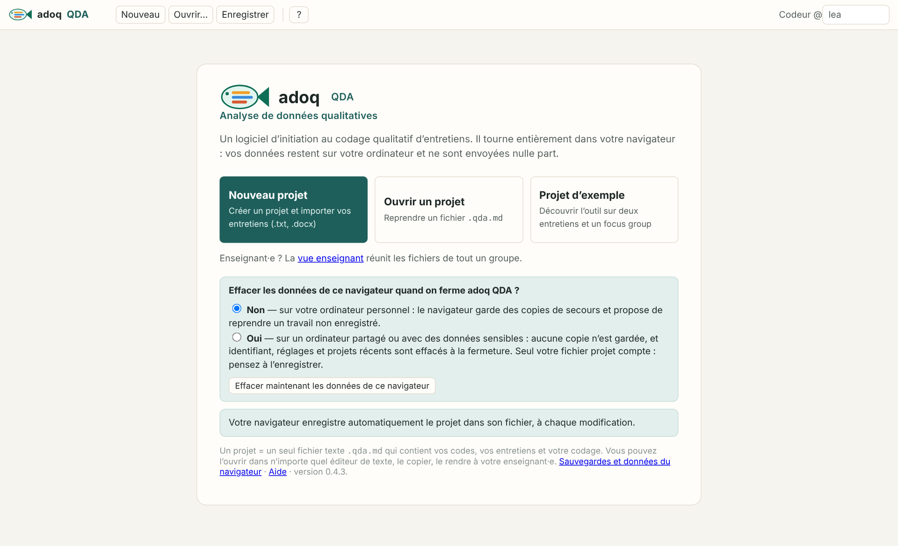

# Installer et ouvrir

## Télécharger

Téléchargez le fichier [`adoq-QDA-0.4.3.html`](../adoq-QDA-0.4.3.html) (le numéro de version fait partie du nom) et rangez-le dans un dossier de votre ordinateur, par exemple le dossier de votre mémoire. **C’est tout** : il n’y a ni programme à installer, ni compte à créer, ni connexion nécessaire.

Pour ouvrir l’application, **double-cliquez sur le fichier** : il s’ouvre dans votre navigateur.

## Quel navigateur ?

L’application fonctionne dans tous les navigateurs récents, mais **l’enregistrement diffère** :

| Navigateur | Enregistrement |
|---|---|
| **Chrome, Edge** (Windows, Mac, Linux) | **Automatique** : vous choisissez une fois où ranger le fichier projet, puis chaque modification y est enregistrée en une seconde. |
| **Firefox, Safari** | **Manuel** : cliquez sur « Enregistrer » (ou `Ctrl+S` / `Cmd+S`). Le projet est téléchargé dans votre dossier Téléchargements. Pour reprendre, rouvrez le **dernier** fichier téléchargé. |

!!! tip "Conseil"
    Utilisez **Chrome ou Edge** pour un travail de longue haleine comme un mémoire : l’enregistrement automatique évite de se retrouver avec `projet (1).qda.md`, `projet (2).qda.md`…

!!! warning "Ordinateur partagé"
    En salle informatique, choisissez sur la page d’accueil **« Effacer les données de ce navigateur quand on ferme adoq QDA ? » → Oui**. Voir [Données et confidentialité](../faq/confidentialite.md).

L’indicateur à côté du bouton « Enregistrer » dit toujours où vous en êtes : **✓ Enregistré** (vert) ou **● Non enregistré** (orange).

## Votre identifiant de codeur

À la première utilisation, l’application vous demande un **identifiant** (initiales ou prénom, sans espace), par exemple `zoe`. Il signe chacun de vos codages (`@zoe`) et permet ensuite de comparer votre codage avec celui d’un·e collègue. Vous pouvez le modifier en haut à droite (« Codeur @ »).

## Mettre à jour

Pour passer à une nouvelle version, remplacez simplement l’ancien fichier (par exemple `QDA-md-Etude-0.2.2.html`, du temps où le logiciel s’appelait QDA-md Étude) par le nouveau, et supprimez l’ancien pour ne pas les confondre. Vos projets (`.qda.md`) sont des fichiers séparés : ils ne sont pas touchés.

!!! warning "N’utilisez qu’une seule version"
    Une version plus ancienne peut ouvrir un projet créé avec une version plus récente, mais elle ignore les informations qu’elle ne connaît pas et les **effacerait à l’enregistrement**. Dans un groupe, tout le monde doit utiliser la même version.
