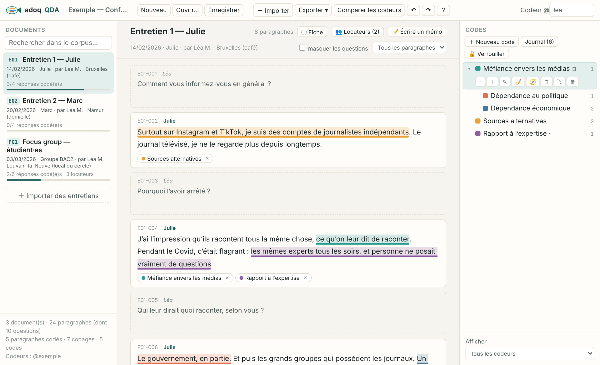
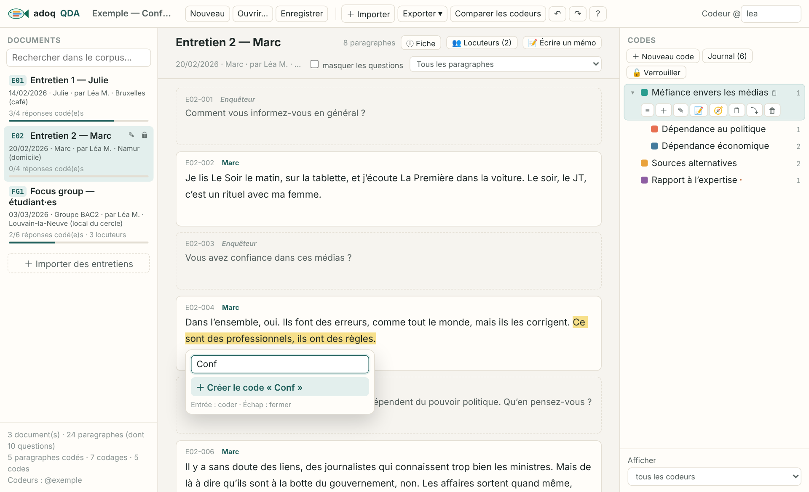
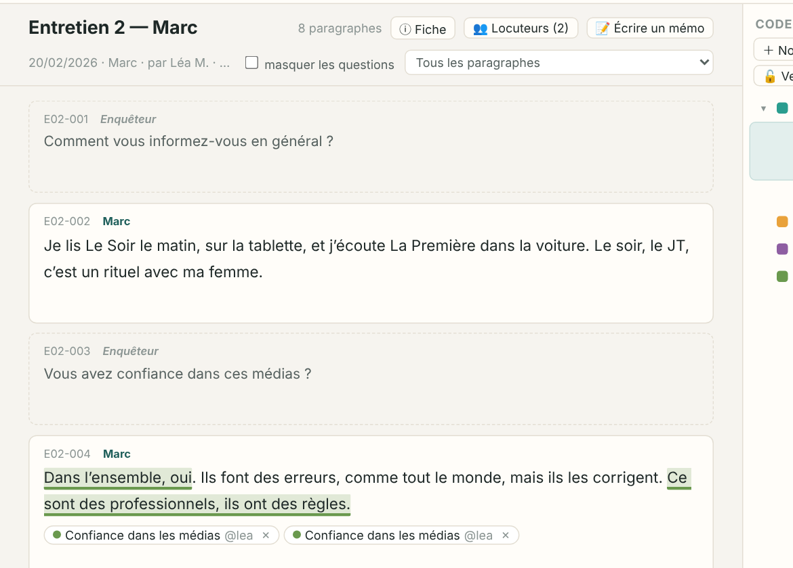

# Prise en main rapide

Ce parcours de dix minutes utilise le **projet d’exemple** : deux entretiens individuels et un focus group sur la confiance dans l’information.

## 1. Ouvrir le projet d’exemple

Sur la page d’accueil, cliquez sur **Projet d’exemple**. L’espace de travail comprend trois colonnes :

- à gauche, les **documents** (un entretien = un document), avec leur fiche et une barre d’avancement ;
- au centre, le **texte** du document choisi, découpé en paragraphes ; les questions de l’intervieweuse apparaissent en pointillés ;
- à droite, l’**arbre de codes**.

## 2. Coder un passage

Ouvrez l’**Entretien 2 — Marc**. Sélectionnez à la souris le passage « Ce sont des professionnels, ils ont des règles. » : une petite fenêtre s’ouvre. Tapez `Confiance dans les médias` puis `Entrée` : le code est créé et appliqué.

Sélectionnez ensuite « Dans l’ensemble, oui » et appuyez directement sur `Entrée` : le dernier code utilisé est proposé en premier.

Le passage codé est surligné et une étiquette apparaît sous le paragraphe. Un même passage peut recevoir plusieurs codes ; les barres de couleur s’empilent.

## 3. Organiser les codes

Dans la colonne de droite, **cliquez sur un code** : ses actions apparaissent (≡ extraits, ＋ sous-code, ✎ renommer, 📝 définition, 🗒 mémo, ⤵ fusionner, 🗑 supprimer). **Glissez-déposez** un code sur un autre pour l’y ranger. Écrivez la **définition** du code que vous venez de créer : le petit point orange disparaît.

## 4. Relire ses extraits

**Double-cliquez** sur « Méfiance envers les médias » : tous les passages qui portent ce code s’affichent, dans leur contexte. Cochez « inclure les sous-codes », puis « Exporter en .md » pour récupérer ces extraits dans un fichier.

## 5. Explorer le focus group

Ouvrez **Focus group — étudiant·es** : chaque prise de parole porte le pseudo de son auteur·e. Choisissez un participant dans le menu « Tous les locuteurs », ou cochez « masquer les questions ». Le bouton **👥 Locuteurs** montre les caractéristiques des participant·es et un tableau « Qui mobilise quels codes ? ».

## 6. Enregistrer

Cliquez sur **Enregistrer** et choisissez un emplacement. Vous savez l’essentiel : passez à [la préparation de vos propres entretiens](preparer-retranscription.md).
