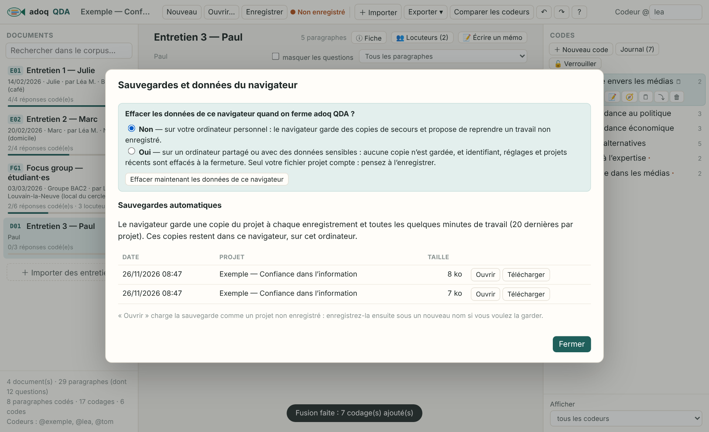

# Données et confidentialité

## Où sont mes données ?

- **Dans votre fichier projet** `.qda.md`, à l’endroit où vous l’avez enregistré. C’est la **seule version de référence** de votre travail.
- **Nulle part ailleurs sur internet** : l’application n’envoie aucune donnée, ne charge aucune ressource extérieure et fonctionne hors ligne.

## Les copies gardées par le navigateur

Pour éviter les pertes, le navigateur garde aussi :

- une **reprise du travail non enregistré** (proposée sur la page d’accueil après une fermeture accidentelle) ;
- jusqu’à **20 sauvegardes automatiques** par projet, que l’on peut rouvrir ou télécharger ;
- la liste des projets récents, votre identifiant et vos réglages.

Les copies contiennent le **texte complet des entretiens**. Elles sont enregistrées **sur le disque**, dans le profil du navigateur, et restent après la fermeture de l’onglet. Les sites web ordinaires n’y ont pas accès, mais **d’autres fichiers HTML ouverts depuis l’ordinateur dans le même navigateur** pourraient les lire, et toute personne utilisant la même session de l’ordinateur peut les retrouver.

## Effacer les données du navigateur à la fermeture

La page d’accueil et le menu **Exporter › Sauvegardes et données du navigateur…** posent la question : **« Effacer les données de ce navigateur quand on ferme adoq QDA ? »**

- **Non** — sur votre ordinateur personnel : copies de secours et reprise du travail restent disponibles.
- **Oui** — sur un **ordinateur partagé** ou avec des **données sensibles** : les données existantes sont effacées immédiatement, **aucune copie n’est plus gardée** pendant le travail, et identifiant, réglages et projets récents sont effacés à la fermeture. Seul ce choix lui-même est mémorisé.

Le bouton **Effacer maintenant les données de ce navigateur** fait le ménage à tout moment. Vos **fichiers projet** ne sont jamais touchés.

!!! warning "Avec « Oui », seul votre fichier compte"
    Sans copie de secours, un travail non enregistré est perdu si l’onglet se ferme. Avec Chrome ou Edge, l’enregistrement automatique dans le fichier protège ; avec Firefox ou Safari, enregistrez souvent.

## Bonnes pratiques

- **Anonymisez** les retranscriptions avant l’import : pseudos, lieux, détails identifiants.
- Rangez le fichier projet dans un **dossier sauvegardé** (OneDrive de l’université, par exemple) et faites-en des copies datées aux étapes importantes.
- **N’ouvrez pas de fichiers HTML d’origine inconnue** dans le navigateur qui vous sert à coder.
- Ouvrez des **exports CSV** venant d’autres personnes avec prudence dans Excel (une cellule commençant par `=` peut contenir une formule).
- Ne téléchargez l’application **que depuis cette page** : une version modifiée qui circulerait entre étudiant·es pourrait, elle, envoyer des données.
