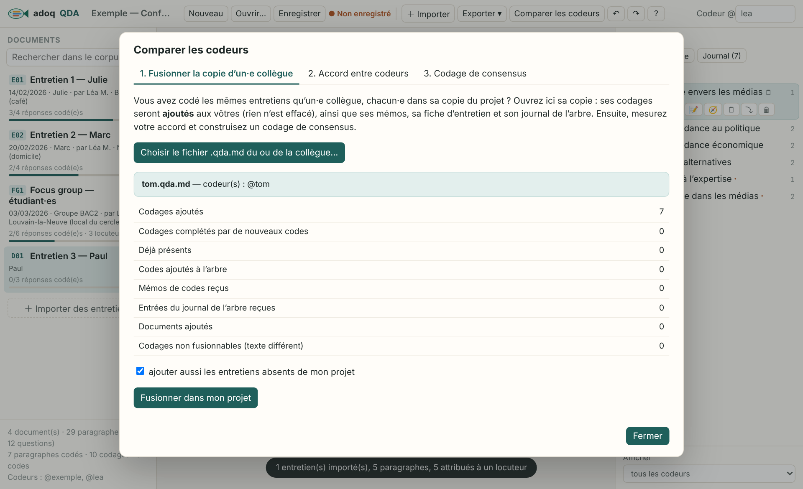
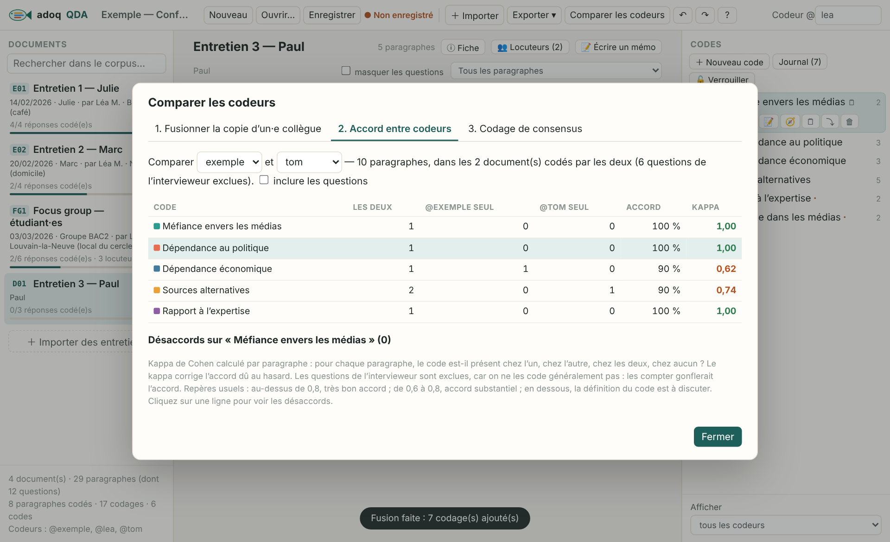
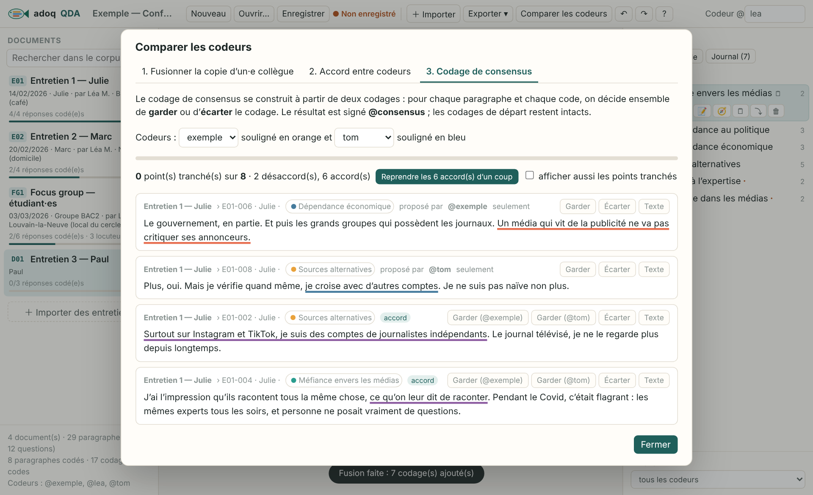
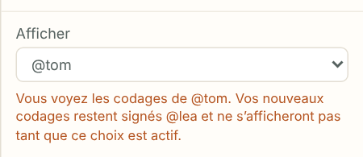

# Travailler à plusieurs

Le **double codage** est un exercice central de l’apprentissage : deux personnes codent le même matériau séparément, puis confrontent leurs choix. adoq QDA l’organise en trois temps, dans **Comparer les codeurs**.

## 0. Coder chacun·e de son côté

Chacun·e travaille dans **sa copie du projet**, avec **son propre identifiant**. Dans le menu **Afficher** (en bas de la colonne des codes), choisissez **mes codages — codage à l’aveugle** pour ne pas être influencé·e par les codages déjà présents.

!!! tip "Partir d’une même base"
    Le plus simple : une personne crée le projet, importe les entretiens, écrit les premières définitions (et éventuellement verrouille l’arbre), puis envoie une copie du fichier à l’autre.

## 1. Fusionner la copie d’un·e collègue

Ouvrez l’onglet **1. Fusionner** et choisissez le fichier `.qda.md` de votre collègue. Un aperçu indique ce qui sera ajouté : codages, codes, mémos, entrées du journal. La fusion **n’efface jamais rien** et ne crée pas de doublons : la refaire ne change rien. Si les deux copies portent le même identifiant, l’application propose de le renommer.

## 2. Mesurer l’accord

L’onglet **2. Accord entre codeurs** calcule, pour chaque code, le **kappa de Cohen** au niveau du paragraphe : pour chaque paragraphe, le code est-il présent chez l’un, chez l’autre, chez les deux, chez aucun ? Les questions de l’intervieweur·euse sont exclues. Cliquez sur une ligne pour voir les **désaccords** et aller au texte.

Repères usuels : au-dessus de **0,8**, très bon accord ; de **0,6 à 0,8**, accord substantiel ; en dessous, la définition du code est à discuter.

## 3. Construire un codage de consensus

L’onglet **3. Codage de consensus** présente chaque point à trancher — un paragraphe et un code, proposé par l’un, l’autre ou les deux. Pour chacun : **Garder** ou **Écarter**. Les accords peuvent être repris d’un coup. Le résultat est signé **@consensus** ; les codages de départ restent intacts.

## Afficher le codage d’une personne

Le menu **Afficher** propose : **tous les codeurs**, **mes codages**, ou n’importe quel codeur du projet — y compris **@consensus**. Vous continuez à coder sous votre propre identifiant ; un rappel s’affiche sous le menu, car vos nouveaux codages restent invisibles tant qu’un autre codeur est affiché.

Pour **retoucher** le consensus lui-même, prenez temporairement l’identifiant `consensus` (« Codeur @ »), puis reprenez le vôtre.
