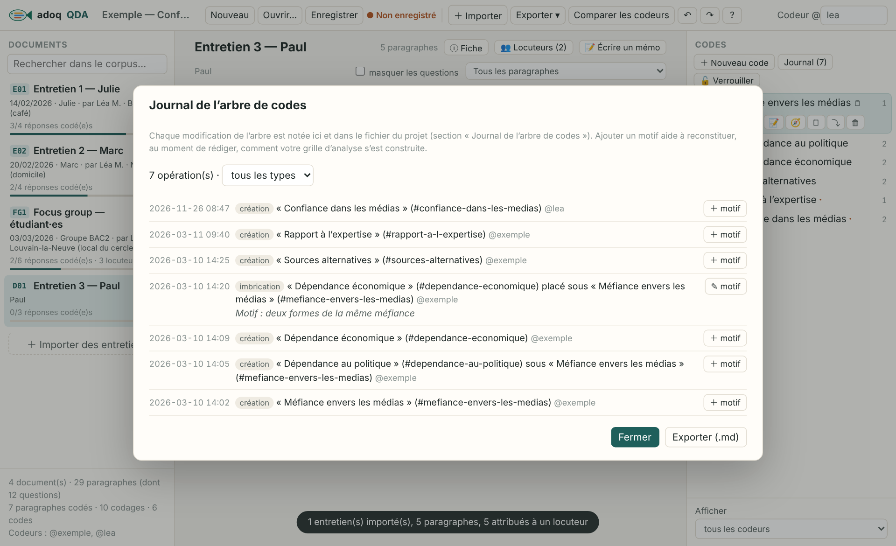

# L’arbre de codes

Les codes sont rangés en **arbre** : un code peut avoir des sous-codes. Cliquez sur un code pour le rendre **actif** et afficher ses actions.


| Action | Effet |
|---|---|
| ≡ | Voir les **extraits** du code (aussi par double-clic) |
| ＋ | Ajouter un **sous-code** |
| ✎ | **Renommer** (l’identifiant dans le fichier ne change pas : les codages restent attachés) |
| 📝 | Écrire la **définition** |
| 🧭 | Noter l’**origine** du code : inductive ou déductive |
| 🗒 | Écrire le **mémo** du code |
| ⤵ | **Fusionner** dans un autre code : tous ses codages passent au code choisi |
| 🗑 | **Supprimer** : ses codages sont retirés, ses sous-codes remontent d’un niveau |

**Réorganiser** : glissez un code sur un autre — au milieu de la ligne pour l’y ranger comme sous-code, au-dessus ou en dessous pour le placer à côté. La zone « Déposer ici… » le remet au premier niveau.

## Définition et mémo

- La **définition** dit *quand appliquer le code* : ce qu’il désigne, un exemple typique, ce qui n’en relève pas. Elle garantit un codage constant et rend la comparaison entre codeurs possible. Un **point orange** signale un code sans définition.
- Le **mémo** recueille vos *réflexions d’analyse* sur ce code : interprétations, hypothèses, liens avec vos lectures, cas limites. Il évolue librement.

## Origine des codes : inductif ou déductif

Un code peut naître de deux façons :

- **inductif** : il est apparu en lisant les entretiens, sans avoir été prévu ;
- **déductif** : il vient de la théorie, d’une hypothèse ou de la question de recherche, et on l’a cherché dans les données.

Le bouton **🧭** permet de le noter, avec, si on veut, la théorie ou l’auteur·e de référence d’un code déductif. Une pastille apparaît devant le nom du code : **I** pour inductif, **D** pour déductif ; le survol rappelle la théorie. L’origine est reprise dans le livre de codes exporté.

Distinguer les deux aide à voir ce que l’analyse doit à la théorie de départ et ce qu’elle doit aux données. C’est aussi la première étape du codage abductif, que propose QDA-md, la version de recherche.

Dans le fichier, l’origine est écrite sous le code, comme dans QDA-md :

```markdown
- Stratégies de vérification #verification
  origine:: deductif
  theorie:: Wardle
  > La personne décrit ce qu'elle fait pour vérifier une information.
```

Changer l’origine est noté dans le journal. Comme la définition, elle ne peut plus être modifiée quand l’arbre est verrouillé.

## Le journal de l’arbre

Le bouton **Journal** liste toutes les opérations sur l’arbre — création, renommage, définition, imbrication, fusion, suppression — avec la date et l’auteur·e. Un **motif** peut être indiqué au moment de la fusion ou de la suppression, ou ajouté ensuite. Au moment de rédiger, ce journal permet de raconter comment votre grille d’analyse s’est construite.



## Verrouiller l’arbre

Le bouton **🔓 Verrouiller** fige l’arbre : on peut encore coder avec les codes existants et écrire des mémos, mais plus créer, renommer, définir, déplacer, fusionner ou supprimer de codes. Un **code de déverrouillage** est facultatif.

C’est utile quand l’enseignant·e distribue un **livre de codes imposé**, ou quand un binôme a stabilisé son arbre avant de coder chacun de son côté.

!!! warning "Un verrou pédagogique"
    Le fichier projet reste un texte modifiable à la main : le verrou évite les modifications par erreur, pas un contournement volontaire. N’utilisez **jamais** un vrai mot de passe comme code de déverrouillage.
