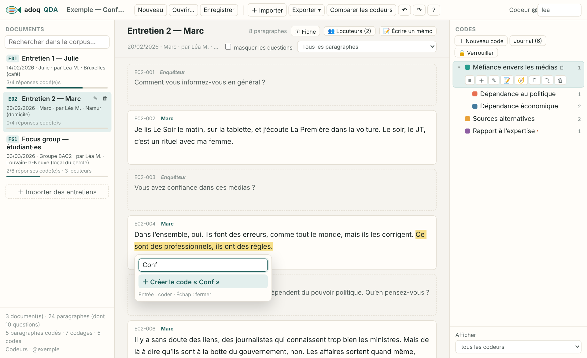
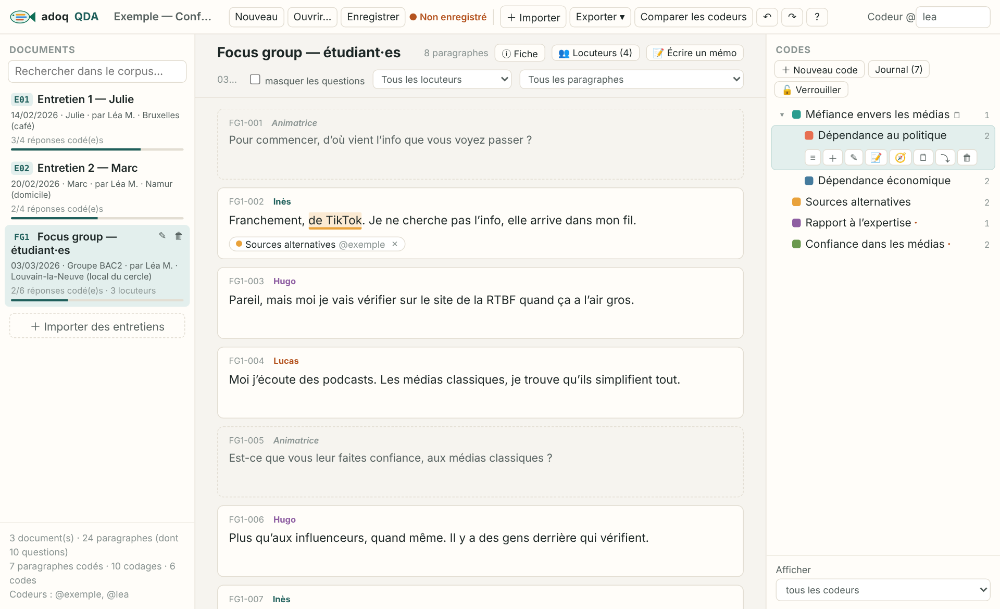

# Coder

## Appliquer un code

1. **Sélectionnez un passage** à l’intérieur d’un paragraphe.
2. Dans la fenêtre qui s’ouvre, **choisissez un code** (flèches et `Entrée`, ou clic), ou **tapez un nom** pour créer un nouveau code.
3. Le **dernier code utilisé** reste en tête de liste : sélection + `Entrée` suffit pour le réappliquer.

Pour coder tout un paragraphe, survolez-le et cliquez sur **＋ paragraphe entier** ; une barre de couleur apparaît dans la marge.

## Plusieurs codes, chevauchements

Un même passage peut recevoir plusieurs codes, et deux passages codés peuvent se chevaucher. Chaque code a sa couleur ; quand plusieurs codes se superposent, leurs barres s’empilent sous le texte.

## Retirer un code

Sous chaque paragraphe, les **étiquettes** montrent les codes appliqués ; dès que le projet compte plusieurs codeurs, chaque étiquette indique aussi qui a codé (`@zoe`). **Survolez** une étiquette pour voir le passage concerné ; cliquez sur **×** pour retirer le code. Toute opération peut être annulée avec `Ctrl+Z` (rétablie avec `Ctrl+Y`).

## Questions et réponses

Les questions de l’intervieweur·euse apparaissent **en pointillés**. On ne les code généralement pas : cochez **masquer les questions** pour ne voir que les réponses. Le filtre « Pas encore codés » ignore lui aussi les questions.

## Se repérer

- **Filtres** en haut du document : paragraphes portant le code actif, paragraphes pas encore codés, un locuteur précis (focus group).
- **Afficher** (en bas de la colonne des codes) : tous les codeurs, seulement vos codages, ou ceux d’un·e autre codeur·euse — voir [Travailler à plusieurs](a-plusieurs.md).
- **Recherche** dans tout le corpus (colonne de gauche) : un clic sur un résultat ouvre le paragraphe.
- **Mémo du document** (📝) : impressions, contexte de l’entretien, premières pistes d’analyse.
- La **barre d’avancement** de chaque document compte les réponses codées.
