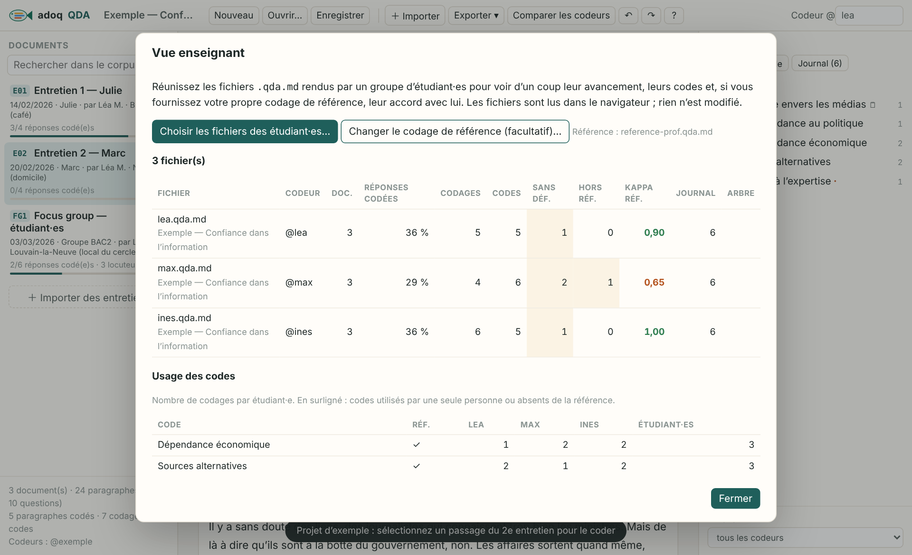

# Vue enseignant

La **vue enseignant** (lien sur la page d’accueil, ou menu **Exporter › Vue enseignant…**) réunit les fichiers `.qda.md` rendus par un groupe. Les fichiers sont lus dans le navigateur ; rien n’est modifié.

1. **Choisir les fichiers des étudiant·es** (plusieurs à la fois).
2. Facultatif : **choisir le codage de référence**, c’est-à-dire votre propre codage du même corpus.

Pour chaque étudiant·e : la part des réponses codées, le nombre de codages et de codes, les **codes sans définition**, les **codes absents de la référence** et le **kappa moyen avec la référence**. Le tableau « Usage des codes » montre qui utilise quoi et met en évidence les codes isolés.

**Ouvrir la synthèse du groupe** crée un projet qui réunit tous les codages, chacun signé par son auteur·e (les identifiants en double sont renommés) : idéal pour **projeter les désaccords en séance**. **Exporter le tableau** produit un fichier CSV.

## Un scénario de travaux pratiques

1. **Préparer** un projet avec deux ou trois entretiens courts, un arbre de codes et ses définitions ; le **verrouiller** avec un code.
2. **Distribuer** le fichier `.qda.md` et le fichier de l’application.
3. Les étudiant·es **codent à l’aveugle**, chacun·e avec son identifiant, puis rendent leur fichier.
4. En séance, **ouvrir la vue enseignant** avec votre codage de référence ; projeter la synthèse et discuter les codes au kappa faible.
5. Par binômes, **fusionner** les copies et construire un **codage de consensus**.
6. Variante inductive : laisser l’arbre déverrouillé et comparer, grâce au **journal**, la manière dont chaque binôme a construit sa grille.
