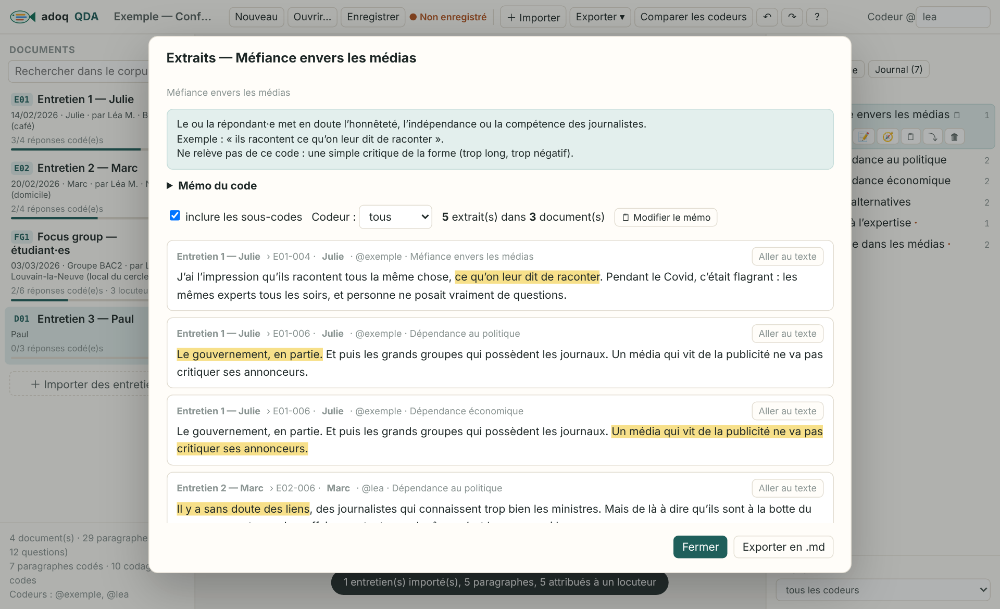

# Extraits et exports

## Extraits d’un code

Double-cliquez sur un code (ou ≡) : tous les passages qui le portent s’affichent **dans leur contexte**, avec le document, le paragraphe, le locuteur et le codeur. Vous pouvez inclure les sous-codes, filtrer par codeur, et revenir au texte d’un clic. La définition et le mémo du code sont rappelés en tête.

**Exporter en .md** produit un fichier lisible (dans Word, Obsidian, un éditeur de texte) que l’on peut citer directement dans un travail : définition, mémo, puis les extraits regroupés par entretien, avec la fiche de l’entretien et les caractéristiques des locuteurs.

## Le menu Exporter

| Export | Contenu | Pour quoi faire |
|---|---|---|
| Enregistrer une copie du projet | le fichier `.qda.md` complet | sauvegarder, rendre son travail, transmettre à un·e collègue |
| Projet en dossier (`.zip`) | le même projet en dossier : `arbre.md` et un fichier par entretien dans `donnees/` | travailler dans QDA-md ou Obsidian, archiver un entretien par fichier |
| Livre de codes (`.md`) | l’arbre, les définitions et les mémos, avec le nombre de codages | annexe d’un mémoire |
| Segments codés (`.csv`) | une ligne par code appliqué : document et son code, fiche, paragraphe, variables Iramuteq, locuteur et ses caractéristiques, code, codeur, citation | analyses dans un tableur, R ou SPSS |
| Matrice documents × codes (`.csv`) | nombre de codages par entretien et par code | comparer les entretiens |
| Matrice locuteurs × codes (`.csv`) | nombre de paragraphes de chaque locuteur portant chaque code, avec ses caractéristiques | focus groups, croisements par âge ou genre |

Les fichiers CSV utilisent le point-virgule comme séparateur et s’ouvrent directement dans Excel ou LibreOffice. Une cellule qui commence par `=`, `+`, `-` ou `@` est précédée d’une apostrophe, pour qu’un tableur ne la prenne pas pour une formule.
