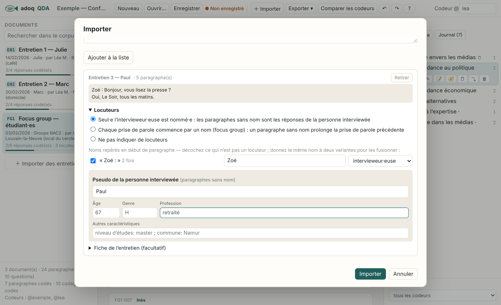
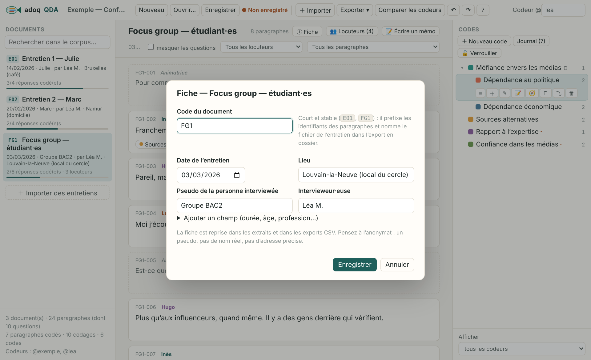
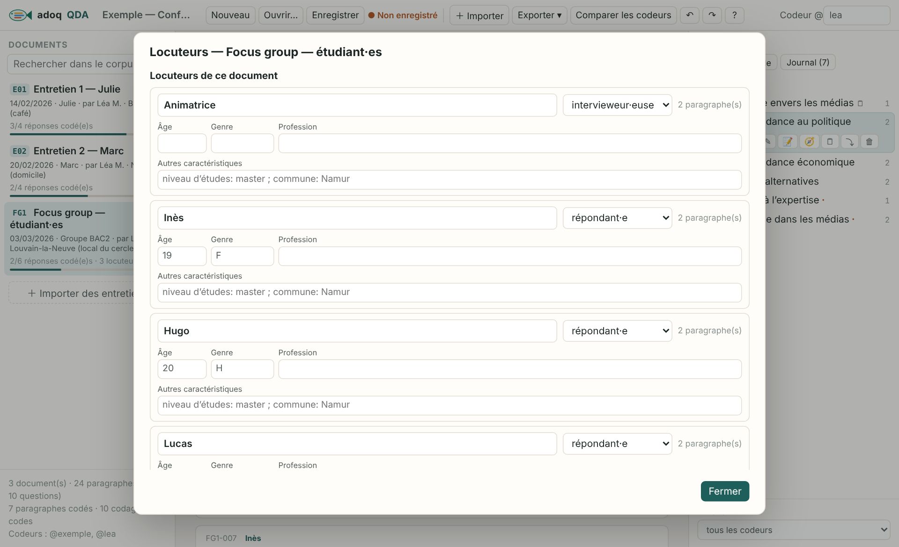

# Importer des entretiens

Cliquez sur **＋ Importer** (en haut) ou **＋ Importer des entretiens** (à gauche). Vous pouvez choisir plusieurs fichiers à la fois, les **glisser-déposer** dans la fenêtre, ou **coller** un texte.

Pour chaque document, l’aperçu montre le nombre de paragraphes, les premières lignes, et trois réglages.

## Locuteurs

Choisissez comment attribuer les paragraphes :

1. **Seul·e l’intervieweur·euse est nommé·e** — les paragraphes sans nom sont les réponses de la personne interviewée. C’est le choix proposé pour un entretien individuel préparé [selon la règle](../demarrer/preparer-retranscription.md#la-regle-des-locuteurs).
2. **Chaque prise de parole commence par un nom** — pour les focus groups.
3. **Ne pas indiquer de locuteurs** — proposé pour un corpus Iramuteq (chaque paragraphe vient d’une personne différente).

La liste des **noms repérés** en début de paragraphe permet de décocher une fausse détection, de corriger un nom, ou de fusionner deux variantes en leur donnant le même nom. Le **rôle** (intervieweur·euse ou répondant·e) est deviné et modifiable.

## Pseudo et caractéristiques

Pour la personne interviewée, indiquez son **pseudo** (à défaut : « Répondant ») et ses **caractéristiques** : âge, genre, profession, et toute autre information sous la forme `niveau d’études: master ; commune: Namur`. En focus group, chaque participant·e nommé·e a ses propres caractéristiques.

Ces caractéristiques s’affichent au survol du nom du locuteur et sont reprises dans les extraits et les exports CSV, ce qui permet de croiser les codes avec l’âge ou le genre.

## Fiche de l’entretien

Facultative : **date**, **pseudo** de la personne interviewée, **intervieweur·euse**, **lieu**. Elle reste modifiable ensuite par le bouton **ⓘ Fiche**, qui permet aussi d’ajouter d’autres champs (durée, contexte…).

## Après l’import

Le bouton **👥 Locuteurs** du document permet à tout moment de renommer ou fusionner des locuteurs, de changer leur rôle, de compléter leurs caractéristiques, et d’attribuer après coup les paragraphes restés sans locuteur. Les codages déjà faits sont conservés. Pour corriger un seul paragraphe, **cliquez sur le nom du locuteur** au-dessus du texte.

## Importer un projet QDA-md

L’onglet **Projet QDA-md** de la fenêtre **＋ Importer** ajoute au projet ouvert un projet entier :

- un **dossier** de projet QDA-md (version de recherche) ou un projet adoq exporté en dossier, qui contient `arbre.md` et `donnees/` ;
- une **archive `.zip`** de ce dossier ;
- un autre fichier **`.qda.md`**.

Un aperçu indique ce qui sera ajouté : documents, codes, codages. Rien n’est effacé dans votre projet : un entretien déjà présent reçoit seulement les codages qui lui manquent, et un code déjà présent garde sa définition. L’import est noté dans le journal de l’arbre de codes.

Les projets de l’ancien format QDA-md (0.9) sont convertis au passage. Les notes placées sous les codes de leur arbre deviennent des mémos de codes.
