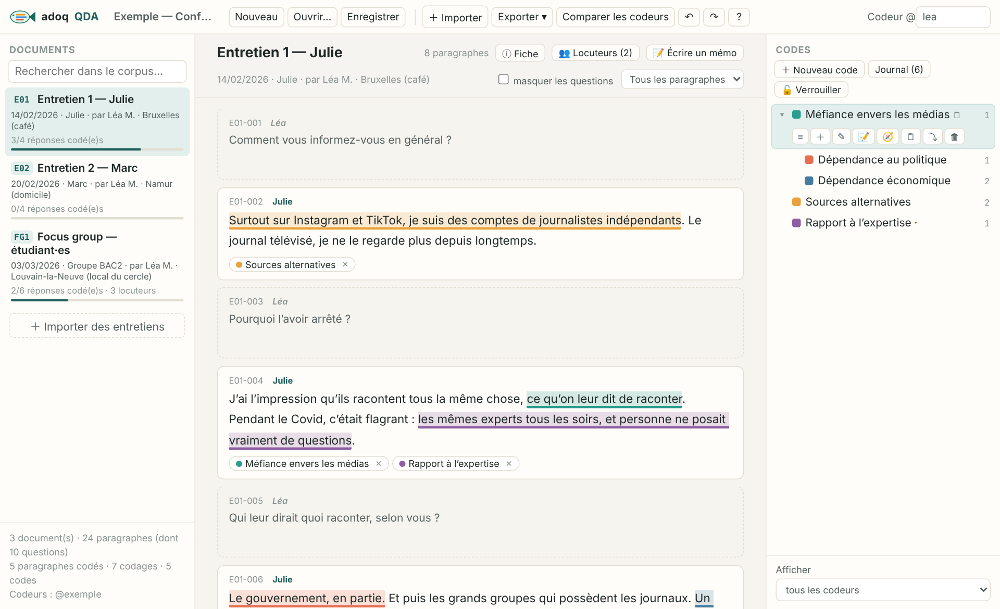

# Qu’est-ce qu’adoq QDA ?

**adoq QDA** (*Analyse de données qualitatives*) est un logiciel conçu pour **apprendre le codage qualitatif d’entretiens**. Il est pensé pour les étudiant·es et leurs enseignant·es : on y importe ses retranscriptions, on surligne des passages, on leur attribue des codes, on organise ces codes en arbre et on compare son codage avec celui d’un·e collègue. Ce sont les gestes de base de l’analyse qualitative assistée par ordinateur, réunis dans un outil volontairement simple.

!!! info "Un outil pour apprendre"
    adoq QDA est optimisé pour l’apprentissage et l’enseignement : il se prend en main en quelques minutes, tient dans un seul fichier et aide l’enseignant·e à suivre le travail d’un groupe. Il est sans doute assez robuste pour un corpus important, puisque plusieurs centaines d’entretiens s’ouvrent en quelques secondes. Il n’est pourtant **pas recommandé pour l’analyse de grands corpus par des équipes de recherche professionnelles**, qui ont besoin de fonctions qu’il laisse volontairement de côté : travail simultané sur un même projet, gestion des droits d’accès, codage de sons et de vidéos, requêtes avancées.

Toute l’application tient dans **un seul fichier HTML**. Il n’y a rien à installer : un double-clic l’ouvre dans le navigateur, elle fonctionne hors ligne et **aucune donnée n’est envoyée sur internet**.

[⬇ Télécharger adoq QDA 0.4.3](adoq-QDA-0.4.3.html){ download="adoq-QDA-0.4.3.html" .btn .btn-neutral }

## adoq QDA peut vous aider si vous…

- découvrez l’analyse qualitative et voulez apprendre à **coder des entretiens** sans investir dans un logiciel payant ;
- préparez un **mémoire** avec une dizaine ou une trentaine d’entretiens ;
- devez **coder à deux** et mesurer votre accord (kappa de Cohen), puis construire un codage de consensus ;
- travaillez sur des **focus groups** et voulez savoir qui mobilise quels thèmes ;
- enseignez la méthode et voulez **suivre le travail d’un groupe** d’étudiant·es.

## Ce qui le distingue

- **Un projet = un fichier texte** (`.qda.md`) lisible dans n’importe quel éditeur : le codage n’est pas enfermé dans une boîte noire, on voit exactement ce qui a été noté. C’est le fichier que l’on enregistre, copie, sauvegarde et rend à son enseignant·e.
- **Les questions et les réponses sont distinguées**, les locuteurs ont un pseudo et des caractéristiques (âge, genre, profession…).
- **La construction de la grille d’analyse est tracée** : chaque création, fusion ou déplacement de code est noté dans un journal, avec son motif.

## Comment commencer ?

1. [Installer et ouvrir l’application](demarrer/installer.md) — deux minutes.
2. [Prise en main rapide](demarrer/prise-en-main.md) avec le projet d’exemple — dix minutes.
3. [Préparer vos retranscriptions](demarrer/preparer-retranscription.md) avant de les importer.

!!! note "Version"
    Ce manuel décrit la version **0.4.3** (novembre 2026). Depuis la 0.4, adoq QDA adopte le **format qda.md** (version 1), commun avec QDA-md. Jusqu’à la version 0.2.2, adoq QDA s’appelait **QDA-md Étude** ; les projets créés avant la 0.4 sont convertis à l’ouverture (voir [Le fichier projet](concepts/format.md)). C’est la version pédagogique de QDA-md, un outil de codage qualitatif pour la recherche.
